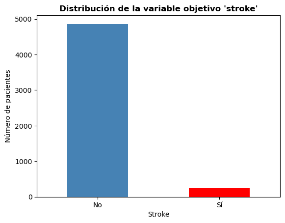
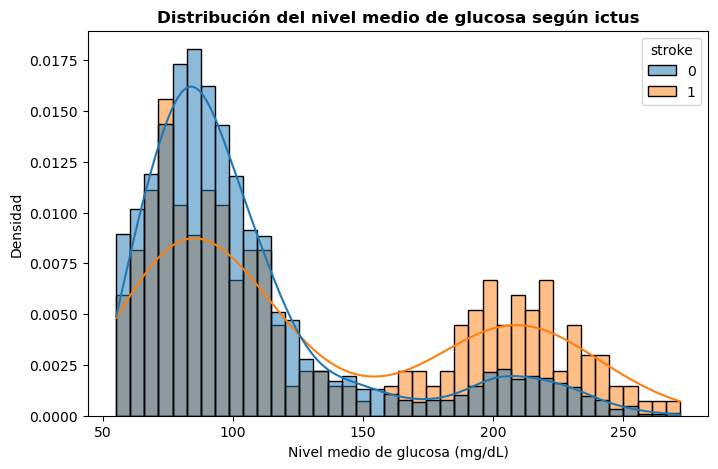
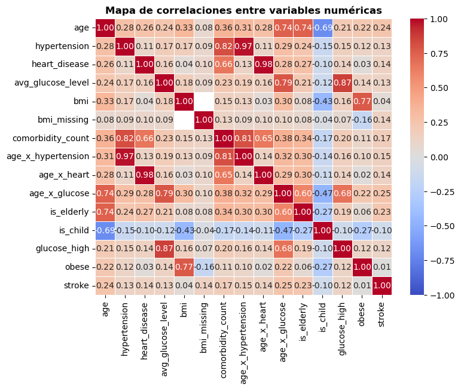
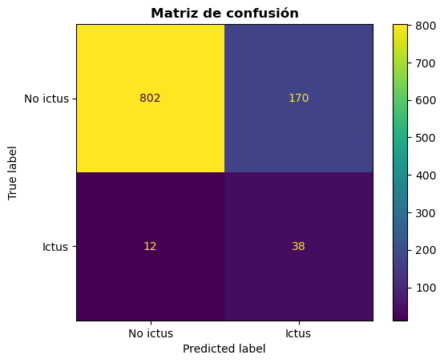
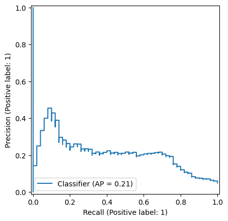
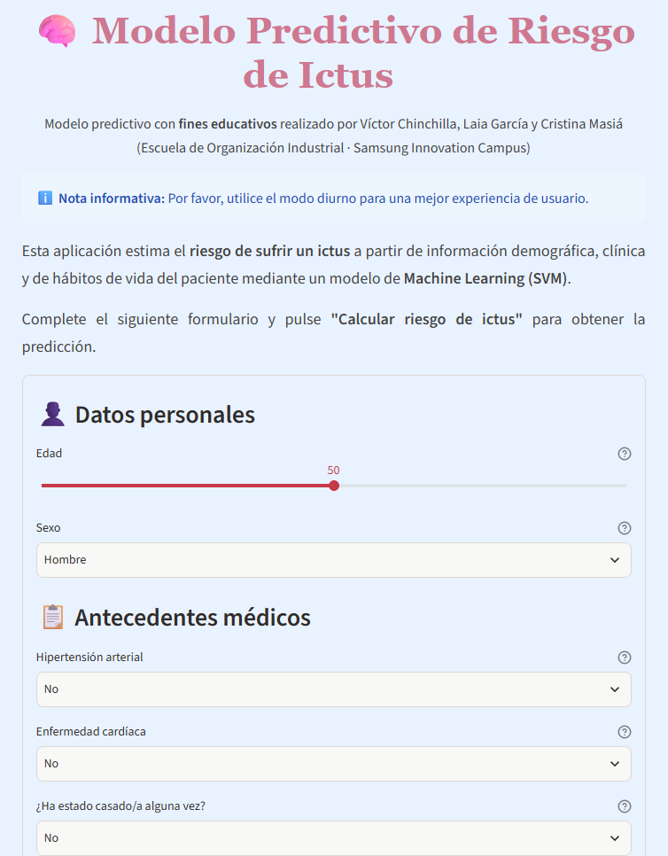
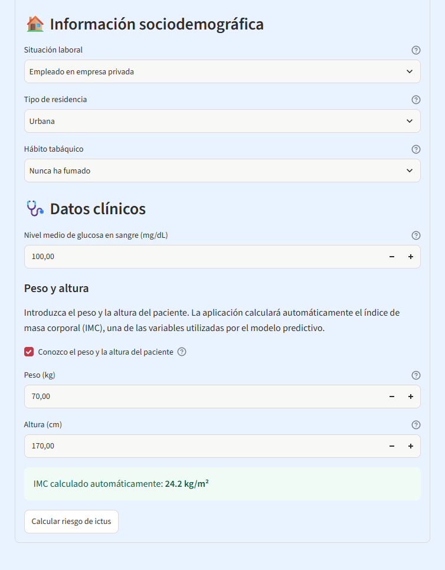
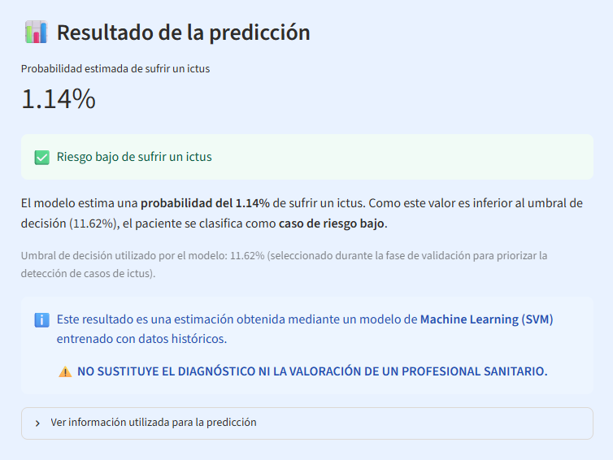

# Predicción del riesgo de ictus


Proyecto grupal desarrollado como trabajo final del curso de Inteligencia Artificial de la **Escuela de Organización Industrial (EOI)** y **Samsung Innovation Campus**. El objetivo fue estudiar los factores asociados al ictus y construir un modelo de Machine Learning capaz de estimar el riesgo a partir de variables demográficas, clínicas y de hábitos de vida.

> **Aviso:** este proyecto tiene fines académicos y demostrativos. La aplicación no ofrece diagnóstico médico ni debe utilizarse para tomar decisiones clínicas.

## Objetivos

- Explorar y comprender un conjunto de datos de pacientes con información relacionada con el ictus.
- Preparar y enriquecer las variables sin modificar la variable objetivo.
- Comparar distintas estrategias de preprocesamiento, balanceo y modelado.
- Seleccionar y evaluar un modelo final manteniendo el foco en la detección de la clase positiva.
- Integrar el modelo entrenado en una aplicación sencilla con Streamlit.

## Datos y análisis exploratorio

El proyecto utiliza el **Stroke Prediction Dataset**, publicado en [Kaggle por `fedesoriano`](https://www.kaggle.com/datasets/fedesoriano/stroke-prediction-dataset). El archivo local `stroke.csv` contiene 5.110 registros y 12 variables originales; su versión enriquecida, `stroke_enriched.csv`, contiene 24 columnas. El enriquecimiento incorpora 12 variables derivadas, entre ellas indicadores de valores faltantes, categorías de edad, glucosa e IMC, recuento de comorbilidades e interacciones con la edad.

El análisis exploratorio revisa:

- El fuerte desequilibrio de la variable `stroke`.
- Los valores faltantes de `bmi`, que se conservan para tratarlos dentro del pipeline.
- La distribución de edad, glucosa, IMC y variables categóricas.
- Las relaciones entre las variables numéricas mediante una matriz de correlación.

La descripción completa de las columnas y de las variables derivadas está disponible en el [diccionario de datos](docs/data_dictionary.md).

<table align="center">
  <tr>
    <td align="center">
      <br>
      <sub>Distribución de la variable objetivo</sub>
    </td>
    <td align="center">
      <br>
      <sub>Distribución de glucosa por clase</sub>
    </td>
  </tr>
</table>
<p align="center">
  <br>
  <sub>Matriz de correlación de las variables numéricas</sub>
</p>

## Metodología

El flujo de trabajo del proyecto incluye:

1. Limpieza y enriquecimiento del dataset.
2. Separación de variables numéricas y categóricas.
3. Imputación y codificación dentro del pipeline de preprocesamiento.
4. Comparación de tres estrategias frente al desequilibrio: sin compensación, pesos balanceados y remuestreo.
5. Evaluación de reducción o selección de variables, incluyendo PCA y `SelectKBest`.
6. Comparación de Logistic Regression, Naive Bayes, Random Forest, XGBoost y SVM.
7. Optimización mediante `GridSearchCV` usando PR-AUC.
8. Selección de un umbral orientado a priorizar el recall.

## Modelo y resultados

El modelo final es un **SVM con kernel RBF**, con `C=0.1`, `gamma='auto'` y `kernel='rbf'`. El umbral utilizado es `0.11622759841539394`.

La elección se basó en la comparación realizada durante el proyecto y en la optimización de PR-AUC. Tras la búsqueda de hiperparámetros, el SVM alcanzó un PR-AUC de validación de `0,255`, frente a `0,228` para Logistic Regression y `0,189` para Naive Bayes. Por este motivo se seleccionó el SVM, aunque la elección debe interpretarse junto con el resto de métricas y el desequilibrio de clases.

Resultados registrados en el notebook original sobre el conjunto de prueba:

| Métrica | Resultado |
|---|---:|
| Accuracy | 0,82 |
| Recall | 0,76 |
| Precision | 0,18 |
| F1-score | 0,29 |
| F2-score | 0,412 |
| ROC-AUC | 0,825 |
| PR-AUC | 0,209 |

La comparación con el clasificador Dummy muestra un PR-AUC de `0,049`, frente a `0,209` para el SVM. El notebook también registra un PR-AUC de validación cruzada de `0,255` y una diferencia de `0,046` respecto al test.

El umbral se ajustó para priorizar el **recall**, es decir, detectar una mayor proporción de los casos positivos. El recall de `0,76` se acompaña de una precisión de `0,18`: el modelo identifica muchos de los casos de ictus, pero también produce falsos positivos. En el conjunto de prueba se registraron 170 falsos positivos y 12 falsos negativos. Este intercambio es coherente con el objetivo de reducir la pérdida de casos positivos, pero limita la utilidad de la predicción como resultado aislado. Frente al clasificador Dummy, el SVM aporta capacidad discriminativa: su PR-AUC es `0,209`, mientras que el Dummy obtiene `0,049`.

Estos resultados deben interpretarse considerando el desequilibrio de clases y el carácter académico del proyecto.

<table align="center">
  <tr>
    <td align="center">
      <br>
      <sub>Matriz de confusión del modelo final</sub>
    </td>
    <td align="center">
      <br>
      <sub>Curva Precision-Recall del modelo final</sub>
    </td>
  </tr>
</table>

## Limitaciones

- La variable objetivo está muy desequilibrada: aproximadamente el 4,87 % de los registros corresponde a casos de ictus.
- La precisión es baja (`0,18`), por lo que una parte importante de las alertas son falsos positivos.
- El dataset contiene un conjunto limitado de variables demográficas, clínicas y de hábitos de vida; no representa toda la información necesaria para una valoración médica.
- `bmi` presenta valores faltantes y, aunque se tratan dentro del pipeline, la ausencia de información puede afectar a la predicción.
- Los resultados proceden de este dataset y de su partición de evaluación. No se ha realizado validación clínica ni validación externa en otra población.
- El dataset y la aplicación tienen fines educativos. El resultado no sustituye la valoración de profesionales sanitarios.

## Aplicación Streamlit

La aplicación permite introducir un perfil de ejemplo y obtener una probabilidad estimada junto con la clasificación basada en el umbral seleccionado durante el proyecto.

Las siguientes capturas muestran un ejemplo de uso con datos ficticios:

<table align="center">
  <tr>
    <td align="center">
      <br>
      <sub>Vista general de la aplicación</sub>
    </td>
    <td align="center">
      <br>
      <sub>Formulario de entrada</sub>
    </td>
  </tr>
</table>
<p align="center">
  <br>
  <sub>Resultado de la predicción para el ejemplo mostrado</sub>
</p>

Con el entorno virtual activado, puede iniciarse desde la raíz del repositorio:

```powershell
streamlit run app/app.py
```

La aplicación recomienda utilizar el modo claro para una mejor experiencia de usuario.

## Tecnologías

- **Lenguaje y entorno:** Python 3.13, Jupyter.
- **Datos:** pandas, NumPy.
- **Machine Learning:** scikit-learn, imbalanced-learn, XGBoost, statsmodels.
- **Visualización:** Matplotlib, Seaborn.
- **Aplicación:** Streamlit.
- **Persistencia del modelo:** joblib.

Las versiones fijadas en [requirements.txt](requirements.txt) corresponden al entorno funcional verificado con Python 3.13.17. No se han podido recuperar todas las versiones utilizadas originalmente; cuando no había una versión histórica disponible, se fijó la versión actual comprobada en ese entorno. `scikit-learn==1.9.0` es necesaria para mantener la compatibilidad con el modelo serializado.

## Estructura del repositorio

```text
stroke-risk-prediction/
├── app/
│   └── app.py
├── assets/
│   ├── figures/
│   │   ├── class_distribution.png
│   │   ├── confusion_matrix.png
│   │   ├── correlation_matrix.png
│   │   ├── glucose_distribution.png
│   │   └── precision_recall_curve.png
│   └── screenshots/
│       ├── app_input_form.png
│       ├── app_overview.png
│       └── app_prediction.png
├── data/
│   ├── processed/stroke_enriched.csv
│   └── raw/stroke.csv
├── docs/
│   ├── data_dictionary.md
│   └── final_report.pdf
├── models/
│   └── stroke_risk_model.joblib
├── notebooks/
│   ├── 01_exploratory_data_analysis.ipynb
│   ├── 02_model_training_and_evaluation.ipynb
│   └── original/stroke_risk_project_original.ipynb
├── .gitignore
├── .gitattributes
├── requirements.txt
└── README.md
```

## Instalación y ejecución

Se recomienda utilizar Python 3.13:

```powershell
py -3.13 -m venv .venv
.\.venv\Scripts\Activate.ps1
pip install -r requirements.txt
```

Después se puede abrir el repositorio como espacio de trabajo en Jupyter o VS Code y ejecutar los notebooks en orden. El notebook de entrenamiento incluye las celdas y resultados del trabajo; no es necesario reentrenar el modelo para ejecutar la aplicación.

## Documentación

- [Aplicación Streamlit](app/app.py)
- [Análisis exploratorio](notebooks/01_exploratory_data_analysis.ipynb)
- [Entrenamiento y evaluación](notebooks/02_model_training_and_evaluation.ipynb)
- [Informe final](docs/final_report.pdf)
- [Diccionario de datos](docs/data_dictionary.md)
- [Notebook original](notebooks/original/stroke_risk_project_original.ipynb)

## Autores

Proyecto realizado por **Víctor Chinchilla Martínez, Laia Garcia Aguilera y Cristina Lian Masiá Gorriz**, Grupo 5.
